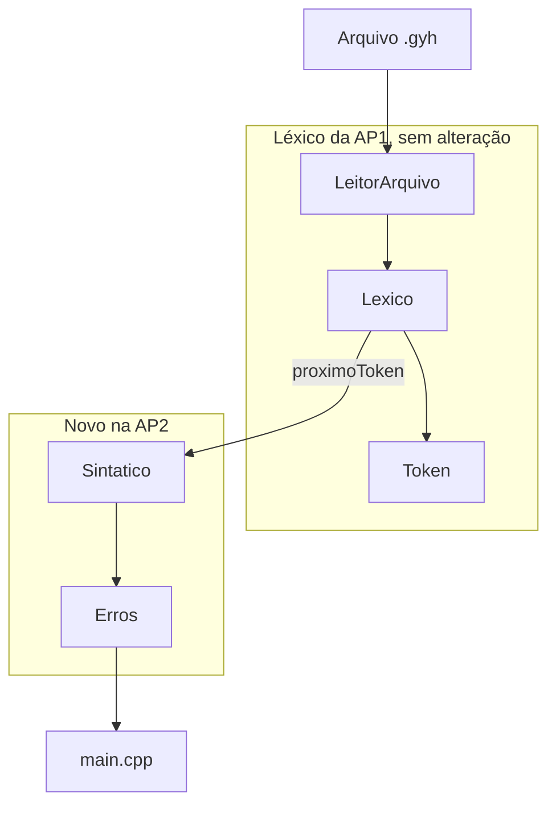

# Analisador Sintático da linguagem GYH

Analisador sintático descendente recursivo, escrito em C++, para a linguagem GYH. Faz parte da 2ª avaliação de Compiladores (UTFPR Apucarana) e consome o analisador léxico desenvolvido na 1ª avaliação, que foi mantido sem nenhuma alteração.

O programa lê um arquivo-fonte, verifica se ele obedece à gramática da GYH e imprime todos os erros léxicos e sintáticos encontrados, cada um com a linha onde ocorreu. Ele não executa o programa nem realiza análise semântica (por exemplo, não verifica se uma variável foi declarada).

Integrantes:

- Maria Eduarda Cardoso de Oliveira (RA 2533880)
- Arthur Francisco da Silva Palma (RA 2369060)

## Estrutura

| Arquivo | Responsabilidade |
|---|---|
| `main.cpp` | Valida o argumento, cria o léxico, o coletor de erros e o parser, imprime o resultado e define o código de saída. |
| `Sintatico.h` | Parser descendente recursivo: um método por não terminal, recuperação de erros e verificação de tipo de expressão. |
| `Erros.h` | Coletor de mensagens de erro, em ordem de ocorrência, que também registra em quais linhas houve erro léxico. |
| `Lexico.h` | Analisador léxico da AP1: reconhece um token por chamada de `proximoToken()`. |
| `LeitorArquivo.h` | Leitura caractere a caractere, devolução de um caractere e contagem de linhas. |
| `Token.h` | Tipo, lexema, id sequencial e linha de cada token. |
| `TipoToken.h` | Enumeração dos 32 tipos de token e o marcador de fim de arquivo. |
| `tests/` | 19 programas de teste (`t01` a `t19`). |

`Lexico.h`, `LeitorArquivo.h`, `Token.h` e `TipoToken.h` são os arquivos da AP1.

## Arquitetura



A cada `avanca()`, o `Sintatico` pede um token ao `Lexico`. Se o lexema for inválido, o `Lexico` lança `ErroLexico`; o parser captura a exceção, grava o erro em `Erros`, descarta o token e pede o próximo. Quando o parser encontra algo fora da gramática, também grava em `Erros`. No fim, o `main` imprime tudo.

## Compilar e executar

Usa apenas a biblioteca padrão. Compila em C++11, C++14 e C++17 sem avisos com `-Wall -Wextra -pedantic`.

```powershell
g++ -std=c++14 -Wall -Wextra -pedantic main.cpp -o analisador_sintatico.exe
.\analisador_sintatico.exe .\tests\t01_fatorial_valido.gyh
```

Para rodar todos os testes de uma vez (PowerShell):

```powershell
Get-ChildItem tests\*.gyh | ForEach-Object { "=== $($_.Name)"; .\analisador_sintatico.exe $_.FullName }
```

Em Linux ou macOS:

```bash
g++ -std=c++14 -Wall -Wextra -pedantic main.cpp -o analisador_sintatico
for f in tests/*.gyh; do echo "=== $f"; ./analisador_sintatico "$f"; done
```

### Códigos de saída

| Código | Significado |
|---:|---|
| 0 | Programa sem erros. |
| 1 | Quantidade incorreta de argumentos. |
| 2 | Arquivo não abriu ou falha de leitura. |
| 3 | Programa analisado com erros (léxicos e/ou sintáticos). |

## A linguagem

Exemplo de programa válido (`tests/t01_fatorial_valido.gyh`):

```
:DEC
parametro:INT
fatorial:INT

:PROG
# Calcula o fatorial de um numero inteiro
LER parametro
fatorial := parametro
SE parametro == 0 ENTAO fatorial := 1
ENQTO parametro > 1
INI
fatorial := fatorial * (parametro - 1)
parametro := parametro - 1
FIM
IMPRIMIR fatorial
```

Resumo do léxico (detalhes das decisões no repositório da AP1):

- Palavras-chave e operadores booleanos em maiúsculas: `DEC`, `PROG`, `INT`, `REAL`, `LER`, `IMPRIMIR`, `SE`, `ENTAO`, `SENAO`, `ENQTO`, `INI`, `FIM`, `E`, `OU`.
- Variáveis começam com letra minúscula: `[a-z][A-Za-z0-9]*`.
- Inteiros `[0-9]+` e reais `[0-9]+\.[0-9]*` (`5.` é real, `.5` é erro).
- Cadeias entre aspas duplas. Comentários começam em `#` e vão até o fim da linha.
- Operadores: `+ - * /`, `< <= > >= == !=`, atribuição `:=`, delimitador `:`, parênteses.

## Gramática

### Gramática implementada

Vocabulário de tokens do léxico (`PCDec`, `Delim`, `Atrib`, `OpRelMaior` etc.). Colchetes indicam parte opcional.

```
Programa    -> Delim PCDec ListaDecl Delim PCProg ListaCmd

ListaDecl   -> Decl ListaDecl'
ListaDecl'  -> Decl ListaDecl' | e
Decl        -> Var Delim TipoVar
TipoVar     -> PCInt | PCReal

ListaCmd    -> Cmd ListaCmd'
ListaCmd'   -> Cmd ListaCmd' | e
Cmd         -> CmdAtrib | CmdLer | CmdImp | CmdSe | CmdEnqto | CmdBloco
CmdAtrib    -> Var Atrib ExpA
CmdLer      -> PCLer Var
CmdImp      -> PCImprimir (Var | Cadeia)
CmdSe       -> PCSe ExpR PCEntao Cmd [PCSenao Cmd]
CmdEnqto    -> PCEnqto ExpR [PCEntao] Cmd
CmdBloco    -> PCIni ListaCmd PCFim

ExpR        -> ExpRel ExpR'
ExpR'       -> (OpBoolE | OpBoolOu) ExpRel ExpR' | e
ExpRel      -> ExpA ExpRel'
ExpRel'     -> OpRel ExpA | e
ExpA        -> TermoA ExpA'
ExpA'       -> (OpAritSoma | OpAritSub) TermoA ExpA' | e
TermoA      -> FatorA TermoA'
TermoA'     -> (OpAritMult | OpAritDiv) FatorA TermoA' | e
FatorA      -> NumInt | NumReal | Var | AbrePar ExpR FechaPar
```

### Transformações aplicadas à gramática original

1. **Recursão à esquerda.** `ExpressaoAritmetica`, `TermoAritmetico` e `ExpressaoRelacional` eram recursivas à esquerda, o que causaria laço infinito em um parser descendente recursivo. Viraram as formas com linha (`ExpA'`, `TermoA'`, `ExpR'`), implementadas como laços `while`.
2. **Prefixo comum.** As listas e o `if` com e sem `else` foram fatorados. Na implementação, a lista continua enquanto o token atual pertence a FIRST(Cmd), e o `else` é consumido se aparecer.

### Pontos de conflito LL(1) e como foram resolvidos

**Else pendente.** `PCSenao` está em FIRST da alternativa do `else` e também em FOLLOW(Cmd), o que gera conflito. A resolução adotada é a convenção das linguagens usuais: o `SENAO` pertence ao `SE` mais próximo (o parser consome o `SENAO` sempre que ele aparece).

**Ambiguidade do parêntese.** Na gramática original, `TermoRelacional -> ExpA OpRel ExpA | '(' ExpR ')'`, e `FatorA` também aceita `'(' ExpA ')'`. Ambas começam com `(`, então um token de lookahead não decide entre `(a + b) > c` e `(a > b) E (c < d)`. Em vez de usar backtracking, o parêntese de `FatorA` passou a conter uma `ExpR`, e cada função de expressão devolve o **tipo** do que leu (aritmética ou relacional). O parser então rejeita as combinações que a gramática original não aceitava:

| Entrada | Resultado |
|---|---|
| `(a + b) > c` | aceita |
| `(a < b) E (c < d)` | aceita |
| `(a > b) + 1` | erro: esperado expressão aritmética, encontrada relacional |
| `a > b > c` | erro |
| `x := (a > b)` | erro: esperado expressão aritmética, encontrada relacional |
| `SE (a + b) ENTAO` | erro: esperado operador relacional |

Assim a linguagem aceita é a mesma da gramática original, sem backtracking.

## Tratamento de erros

| Situação | Comportamento |
|---|---|
| Erro léxico | Registrado em `Erros`; o token inválido é descartado e a análise continua. O léxico já consumiu o lexema antes de lançar a exceção, então a próxima chamada segue do ponto certo. |
| Token esperado que falta | Registra o erro e segue como se o token tivesse sido inserido (recuperação local). Produz a mensagem do slide para `parametro INT`. |
| Comando inesperado | Registra o erro e descarta tokens até uma palavra que inicia comando, `FIM` (dentro de bloco) ou fim de arquivo. Uma variável só serve de ponto de recomeço se estiver em linha posterior à do erro. |
| Cascata | No máximo um erro sintático por token. |
| Erro sintático em linha com erro léxico | Suprimido (costuma ser só consequência do token descartado). |

Garantia de terminação: todo laço do parser consome pelo menos um token por iteração. Isso foi verificado também com 3000 arquivos gerados aleatoriamente, sem travamento nem falha.

### Formato das mensagens

```
Erro lexico na linha 9: Desconhecido "="
Erro sintatico na linha 2: esperado delimitador ':' antes de PCInt
Erro sintatico na linha 6: esperado expressao aritmetica, encontrada expressao relacional
```

Saída completa do exemplo com erros (`tests/t02_slide6_erros.gyh`):

```
Erro sintatico na linha 2: esperado delimitador ':' antes de PCInt
Erro lexico na linha 9: Desconhecido "="
Erro lexico na linha 13: Desconhecido "="
3 erro(s) encontrado(s).
```

## Testes

Cada arquivo em `tests/` exercita uma regra ou um tipo de erro:

| Arquivo | Cenário | Resultado esperado |
|---|---|---|
| `t01` | fatorial completo | sem erros |
| `t02` | exemplo de erros do slide | 1 erro sintático (linha 2) e 2 léxicos (linhas 9 e 13) |
| `t03` | declaração sem tipo | esperado tipo antes de `Var` |
| `t04` | `SE` sem `ENTAO` | esperado `PCEntao` |
| `t05` | else pendente | sem erros |
| `t06` | parêntese não fechado | esperado `')'` |
| `t07` | `INI` sem `FIM` | esperado `PCFim` antes de `EOF` |
| `t08` | relacional entre parênteses com `E`/`OU` | sem erros |
| `t09` | `SE (a + b) ENTAO` | esperado operador relacional |
| `t10` | `:PROG` sem comandos | esperado comando antes de `EOF` |
| `t11` | `FIM` sobrando | esperado comando antes de `PCFim` |
| `t12` | `a > b > c` | 1 erro, sem cascata |
| `t13` | `x := (a > b)` | esperado expressão aritmética |
| `t14` | `IMPRIMIR 5` | esperado variável ou cadeia |
| `t15` | programa sem `:DEC` | esperado delimitador `':'` |
| `t16` | `ENQTO` aninhado com reais | sem erros |
| `t17` | `@` solto e `IMPRIMIR x x` | erro léxico seguido de erro sintático |
| `t18` | arquivo vazio | esperado delimitador `':'` antes de `EOF` |
| `t19` | `x := 1 +` | esperado operando |

## Pontos configuráveis

Duas constantes no topo de `Sintatico.h` isolam decisões que dependem da especificação do professor:

| Constante | Padrão | Efeito |
|---|---|---|
| `ENQTO_EXIGE_ENTAO` | `false` | Se `true`, o `ENQTO` passa a exigir `ENTAO` antes do comando, como no `while ... then` do PDF da gramática. O exemplo do slide usa `ENQTO` sem `ENTAO`. |
| `SUPRIMIR_SINTATICO_EM_LINHA_COM_ERRO_LEXICO` | `true` | Se `false`, erros sintáticos consequentes de um erro léxico na mesma linha também são mostrados. |

## Limitações

- O analisador verifica apenas a sintaxe. Não há tabela de símbolos, verificação de variáveis declaradas ou de compatibilidade entre `INT` e `REAL`.
- Não constrói árvore sintática.
- Um erro de "token faltante" é reportado na linha do token seguinte. Por exemplo, um `)` que falta no fim de uma linha aparece na linha do próximo comando.
- O léxico lê byte a byte em ASCII. Caracteres não ASCII fora de cadeias e comentários (por exemplo o travessão `–`) geram um erro léxico por byte.
